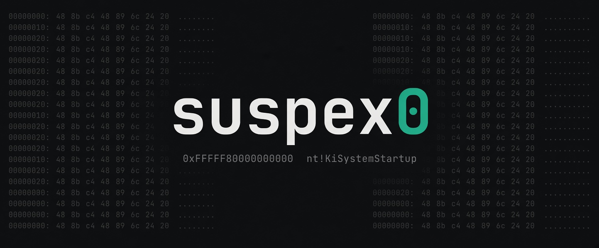
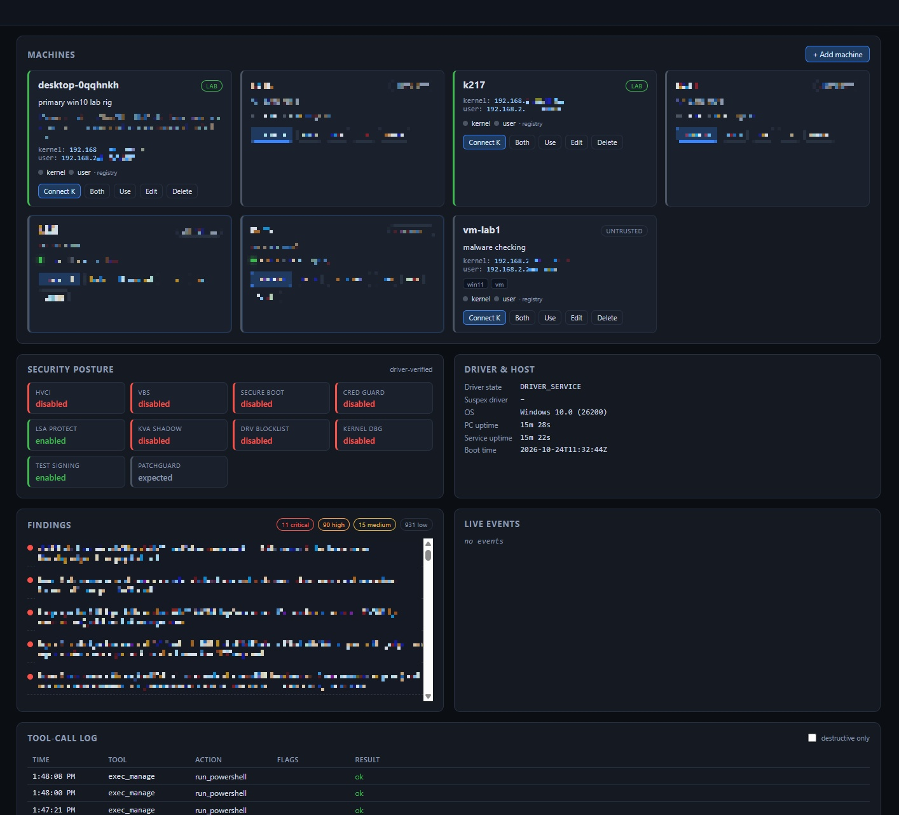

<p align="center">
  
</p>

# Suspex0 — AI-driven Windows security research & pentesting platform

Suspex0 turns any MCP-capable LLM into an autonomous pentester for **authorized
Windows lab environments**. An MCP client (Claude, Kilo, Cursor, any agent
framework) connects to a single Suspex0 MCP server and gets consolidated tools
for reconnaissance, memory-level instrumentation, user/kernel debugging,
exploit development support, and PoC generation against a Windows target VM.

## Authorized use only

This software is for security assessment in environments you own or are
explicitly authorized to test. Targets are allowlist-gated (`authorized_targets`
CIDR list), services bind per configuration (MCP/dashboard default to
`127.0.0.1`), and the agent link is bearer-token authenticated.

Because dynamic analysis of malware and other hostile samples requires the
agent to counter the target's own anti-analysis behavior, suspex0 does ship
**target-facing anti-anti-analysis primitives** (debugger-probe spoofing,
syscall-callback tracing, hook-based observers). These are aimed at the
sample under study, not at the analyst's host defenses. The authorization
model still stands: only run this against lab targets you own or are
explicitly cleared to touch.

## Architecture

```
MCP client (LLM)
   │  streamable-HTTP (127.0.0.1:8765/mcp)
   ▼
Orchestrator (Python 3.12, FastAPI + FastMCP + grpcio)
   │  gRPC (unary + server-streaming), bearer token
   ▼
Agent (suspex_agent.exe, C++20, runs on target as service or console)
   ├── comm/       IOCTL broker → suspex_driver.sys (KMDF)
   ├── DbgEng      user-mode debugging (bps/regs/step/symbols)
   ├── Files       upload/download/hash/delete/dump_module
   ├── Exec        processes, cmd/PowerShell one-shots + persistent shells
   └── dump/       file-layout PE reconstruction
Driver (suspex_driver.sys): user/kernel/physical memory R/W, module lists,
thread context + DR0-3, sw/hw breakpoints, kernel-initiated user APC remote call
Mapper (mapper.exe): custom manual-map loader (relocations, imports, APC trigger) — deprecated
IDA bridge: streamed binaries → artifacts/<sha256>/ → headless idalib-mcp
(mrexodia/ida-pro-mcp) proxied through the ida_manage tool
Findings: SQLite ledger + markdown/HTML report generator (durable LLM state)
Dashboard: static SPA + WebSocket live feed served by the orchestrator
```

> **Deprecated:** `mapper.exe` is deprecated and kept only for existing
> workflows. Stealth / manual-mapping features will be added in a later
> release; the supported path today is loading the driver as a service via
> `target_manage(action='driver_load', method='service')`.

## Repository layout

| Path | What |
|---|---|
| `proto/suspex.proto` | agent control plane (all RPCs, status envelope) |
| `driver/` | `suspex_driver.sys` KMDF driver (C, WDK) |
| `comm/` | user-mode C++ driver comm lib (ABI header + static asserts) |
| `tools/` | `drv_exerciser.exe` — one subcommand per IOCTL (safety gate) |
| `mapper/` | manual-map loader console exe (deprecated; stealth features planned) |
| `agent/` | `suspex_agent.exe` gRPC server (service or `--dev`) |
| `orchestrator/` | Python 3.12: MCP server, agent client, IDA bridge, findings, dashboard |
| `scripts/` | build, deploy, install, smoke tests, roundtrip verification |
| `configs/example.yaml` | orchestrator config template |
| `configs/mcp_clients/` | per-client MCP registration snippets (Claude Code, Claude Desktop, Kilo, Cursor, Antigravity) |
| `.mcp.json` / `.kilo/kilo.json` / `.agents/` | project-scope MCP & skills auto-discovered by Claude Code / Kilo / Antigravity |

## Prerequisites

Build host:
- Visual Studio 2022/2026 with C++ tools + CMake ≥ 3.28, WDK (KMDF 1.33+)
- vcpkg (grpc is fetched: `vcpkg install grpc:x64-windows-static`)
  - if `VCPKG_ROOT` lives on an **exFAT** volume (e.g. `D:\vcpkg`), set
    `VCPKG_DOWNLOADS` to an NTFS path (`C:\vcpkg-downloads`) — tool extraction
    (perl etc.) fails on exFAT ("Can't restore time")
- uv (orchestrator env) — https://docs.astral.sh/uv/
- buf (optional; Python stubs generate via grpcio-tools, C++ via vcpkg protoc)

Orchestrator host (may be the build host):
- IDA Pro 8.3+ / 9 with **activated idalib** (`<IDA>\idalib\python\py-activate-idalib.py`)
  for the `ida_manage` tools. Checked at startup with actionable errors; MCP
  server runs fine without IDA if you don't use `ida_manage`.

Target (Windows 10/11 x64 lab VM — snapshot first):
- Admin rights; `bcdedit /set TESTSIGNING ON` + reboot for the driver
- For manual mapping: HVCI/VBS must be off (agent reports HVCI at connect)

## Quickstart

```powershell
# 1. build everything (driver, comm, exerciser, mapper, agent, python stubs)
cd suspex0
.\scripts\build.ps1                     # -SkipDriver to build user-mode only

# 2. deploy to the lab VM (enable testsigning, copy, install agent service)
.\scripts\deploy_to_vm.ps1 -Computer 192.168.56.10 -Dest C:\suspex

# 3. orchestrator
cd orchestrator
uv sync
uv run suspex-server --config ..\configs\example.yaml

# 4. point your MCP client at http://127.0.0.1:8765/mcp
#    (see configs/example.yaml for bind/token/allowlist)

# 5. LLM-free smoke + driver gate on the target
python ..\scripts\smoke_mcp.py
.\scripts\verify_roundtrip.ps1 -Computer 192.168.56.10
```

## MCP client registration

Suspex0 exposes one streamable-HTTP MCP endpoint (default
`http://127.0.0.1:8765/mcp`). Every MCP-capable LLM front-end takes the same
URL — only the wrapper JSON and its location differ. Ready-to-paste snippets
live in [configs/mcp_clients/](configs/mcp_clients/); the common ones are
inlined below.

### Kilo

Project-scope registration is already committed at [.kilo/kilo.json](.kilo/kilo.json).
Toggle the `suspex0` server on via `/mcps` in Kilo once the orchestrator is up.

```json
{ "mcpServers": { "suspex0": { "url": "http://127.0.0.1:8765/mcp" } } }
```

### Claude Code (CLI)

Project-scope registration is already committed at [.mcp.json](.mcp.json) — open
the repo in Claude Code and approve the prompt to trust the project-scope
server (or run `/mcp` to review it). For user-scope registration (available in
every project on this machine), run:

```powershell
claude mcp add --transport http suspex0 http://127.0.0.1:8765/mcp
```

The `.claude/commands/orchestrator.md` slash command mirrors the Kilo one:
`/orchestrator` starts the server and verifies the endpoint.

### Claude Desktop

The desktop app reads `%APPDATA%\Claude\claude_desktop_config.json` (Windows) /
`~/Library/Application Support/Claude/claude_desktop_config.json` (macOS).
The installer script merges the suspex0 entry into whatever the user already
has (backing up the previous file):

```powershell
powershell -ExecutionPolicy Bypass -File scripts\install_claude_desktop.ps1
# older Claude Desktop builds without streamable-HTTP support:
powershell -ExecutionPolicy Bypass -File scripts\install_claude_desktop.ps1 -StdioFallback
# undo:
powershell -ExecutionPolicy Bypass -File scripts\install_claude_desktop.ps1 -Remove
```

Then restart Claude Desktop. Manual snippet if you'd rather edit the file:

```json
{ "mcpServers": { "suspex0": { "type": "http", "url": "http://127.0.0.1:8765/mcp" } } }
```

### Devin

Project-scope registration is already committed at
[.devin/mcp_config.json](.devin/mcp_config.json) — open the repo in Devin
(CLI or Desktop) and the `mcp__suspex0__*` tools show up once the
orchestrator is up. Tool calls are permission-gated via `ask` in
[.devin/config.json](.devin/config.json) (same posture as Kilo's
`suspex0_*: ask`). The `/orchestrator` and `/suspex0` skills under
`.devin/skills/` mirror the Kilo/Claude command + stack-knowledge files.

For user-scope registration (available in every project on this machine),
run:

```powershell
devin mcp add -s user suspex0 http://127.0.0.1:8765/mcp
```

or edit `%APPDATA%\devin\mcp_config.json` directly:

```json
{ "mcpServers": { "suspex0": { "url": "http://127.0.0.1:8765/mcp", "transport": "http" } } }
```

Personal overrides (never committed) go in `.devin/mcp_config.local.json`.

### Antigravity

Project-scope registration is committed at
[.agents/mcp_config.json](.agents/mcp_config.json) and [.agents/skills/](.agents/skills/).
Antigravity automatically discovers the `suspex0` and `orchestrator`
skills directly from `.agents/skills/`, as well as project rules from `AGENTS.md` and `GEMINI.md`.

For global registration across all workspaces, edit `~/.gemini/config/mcp_config.json`:

```json
{
  "mcpServers": {
    "suspex0": {
      "url": "http://127.0.0.1:8765/mcp"
    }
  }
}
```

### Other clients

Any MCP client that speaks streamable-HTTP works — point it at
`http://127.0.0.1:8765/mcp` with no auth. See
[configs/mcp_clients/README.md](configs/mcp_clients/README.md) for adding a
new client without breaking the existing ones.

## MCP tool surface

Consolidated manage-style tools — one tool per domain, an `action` param per
operation, deliberately no tool sprawl. Every tool self-describes:
`action="actions"` returns its live action list,
`target_manage(action="tool_index")` dumps the whole surface, and an unknown
action comes back as "expected one of: …".

<!-- tool-table:start -->
| Tool | Coverage |
|---|---|
| `bin_manage` | Static binary analysis without IDA — artifact `path`/`sha256` or a live module image (`source="memory"`). Parse: info, sections, imports, exports, hashes, imphash, sec, caps. Byte surface: strings, iocs, entropy, scan. Engine: funcs, disasm_func, cfg, xrefs, paths, callgraph — images over ~512 KiB exec background the inventory build (`analyze`, `analyze_status`, `analyze_list`; re-issue once `done`, it hits the warm cache). Drivers: irp_surface, ioctl_surface. Plus audit, diff, pseudo and the ROP passes gadgets, gadget_check, chain_check. |
| `bp_manage` | add / remove / enable / disable / list for software (int3 via dbgeng) and hardware (DR0–3 via the driver, per-thread or `global`) breakpoints; events drains hw-BP hits (kernel int1 hook, DbgEng debug-port fallback for user-space bps). |
| `debug_manage` | DbgEng user-mode debugging: launch, attach, detach, continue, step_into / step_over, regs / set_regs, threads, stacktrace, read, write, regions, events (from_seq replay), cmd (raw dbgeng). |
| `device_manage` | ioctl — send one CTL_CODE to a device (double-gated actuator; a bad code can bugcheck the target); read-only etw_providers / etw_sessions inventory. |
| `dump_manage` | Kernel/usermode crash-dump triage without leaving MCP: `latest` pulls the newest `C:\Windows\Minidump\*.dmp` off the target and parses it (bugcheck code+name, the 4 params, context, stack qwords — resolved to module!sym+off when the dump is same-boot-fresh); `parse` takes a local `path`, an artifact-store `sha256`, or a `remote_path` pulled first. Suspex-watchdog bugchecks self-identify (`fired_by='suspex_watchdog'`). |
| `emulate_manage` | CPU-emulation sessions (speakeasy default, unicorn escape hatch; codegen extra): create, load_shellcode / load_pe, run, step, regs / set_regs, mem_read / mem_write / map / unmap, hook_add / hook_remove, snapshot / restore, seed_from_target, list, close. |
| `event_manage` | Kernel notify-event stream (process/thread create+exit, image load, bp_hit): subscribe, poll, unsubscribe, list, stats. |
| `exec_manage` | run_exe (args_list for quoting-safe args), run_cmd, run_powershell (script_b64 for -EncodedCommand), run_script (upload local_path / inline script=, shell auto-detect); background=true detaches any run_* verb via run_detached; run_detached + detached_status / detached_tail / detached_kill for anything that can hang; timeout_s per-call orchestrator deadline; persistent shells (start_shell / write_console / read_console / stop_shell); kill_process, suspend, resume; call (v15 — synchronous in-context function call: remote thread + param-block trampoline for `space='user'`, driver work-item thunk at PASSIVE_LEVEL for `space='kernel'`; returns rax + exception/timeout detail; gated by `security.allow_function_call`, address accepts `module!export` / `module+offset`). |
| `file_manage` | upload / download (recursive=true mirrors a remote dir tree into artifacts/downloads/), read (inline ranged file bytes, decode=, side='orchestrator' for artifacts), dump_module (user + kernel PE dumps), hash, list_dir (remote FS), delete, yara, tail, follow_start / follow_poll / follow_stop / follow_list (streamed `tail -f`); orchestrator-side artifacts: read_artifact, grep_artifact, list_artifacts, ingest (local file → artifacts/). |
| `ghidra_manage` | Headless Ghidra engine (opt-in `ghidra.enabled`): same session surface as ida_manage (open, open_async, open_status, list, close, schemas, jobs) over ONE shared JVM + shared project hosting N programs. Decompile, disasm, P-code, xrefs, callgraph, imports/exports, strings, pattern/qword scans, rename/retype/comment/patch, struct layout (`dump_layout` feeds symbols_manage), `exec_ghidra_script` escape hatch; every other action forwards verbatim as a pyghidra backend tool name. Needs Ghidra install + JDK + pyghidra; see `ghidra:` block in configs/example.yaml. |
| `ida_manage` | Headless idalib-mcp sessions: open, open_async, open_status, list, close, schemas; shim extensions create_function, exec_idapython, idb_save, ida_status, ida_log, get_struct_member; every other action forwards verbatim as an idalib-mcp tool name. |
| `knowledge_manage` | Shared cross-agent knowledge base: record, update, list, add_evidence, sessions, about, search (FTS), annotate, link, mark_stale, artifacts, export_json. `findings_manage` remains as a deprecated alias. |
| `mem_rw` | read / write / alloc / free / protect across user, kernel and physical space; probe_va; inventory: modules, process_list, threads, vad, handles, imports, exports, heaps, phys_ranges, pool_scan, obj_enum, va_translate; pattern_scan + scan_start / scan_status / scan_result / scan_cancel / scan_list background jobs; watch / watch_list / watch_stop change polling; resolve (address ↔ module+offset), resolve_range / dps (every pointer qword in a range → module!sym+off), dt (`value='_KTRAP_FRAME'` named-type read), idt (per-CPU IDT dump, off-allowlist handlers flagged `suspicious`), walk_list, read_qwords, read_unicode_string, read_ansi_string, `decode=` (PDB-decoded struct reads); strings / iocs / entropy over a live range; disasm / assemble (codegen extra; honors `space='physical'`). |
| `reg_manage` | Remote registry get / set / enum / delete — `wow64_32` 32-bit view, `create_subkey`, `recursive` subtree delete, `impersonate` for another user's HKCU. |
| `screen_manage` | Visual inspection of the interactive session (v15 — runs in a session-1 worker re-launch; a Session-0 service can't see the user desktop): `capture` screenshots the desktop (DXGI duplication) or one window (WGC by hwnd/pid/title/process_name) to artifacts/screenshots/ (dims, sha256, opt-in `embed` base64); `windows` lists windows grouped by process in Z order with full metadata (class, style/exstyle, status, window/client rects, placement, z-order, owner/parent, pid/tid, process path, hinstance, visible/enabled/min/max/topmost/layered/toolwindow/cloaked, dpi) — `include_hidden=True` opts into hidden/invisible/cloaked windows, `include_details=False` for the compact legacy list; `displays` shows monitor topology. |
| `script_manage` | Plugins under `plugins/` (local `scripts_user/` overlay shadows them): list, run, history. |
| `symbols_manage` | PDB-backed symbol/type queries: info, ensure (MSDL download/cache), resolve (name → RVA/VA), lookup (VA → nearest symbol), layout; IDA-dumped layout cache: struct_info, resolve_member, enum_info, layouts. |
| `target_manage` | connect / disconnect / reconnect of named target views (`kernel` driver-backed, `name='user'` driver-free umagent), status, targets, sysinfo, host_info (machine + security-posture fingerprint), driver_load / driver_unload (response carries merged driver/service state), parity (kernel-vs-usermode byte-for-byte check), wait_connectable, wait_boot_change (block until the view's boot identity flips — post-BSOD reconnect), post-crash forensics (recent_ops, recent_ops_agent, crash_state — auto-pulls + parses the newest target minidump on new_boot or `include_dump=true`). Multi-agent: whoami, list_peers, release_peer, subscribe_peers. Machine registry (v0.30): machines_register / machines_set / machines_unregister / machines — purpose/note/trust metadata + endpoints persisted in artifacts/targets.json (no restart); trust gates actuator verbs via `security.min_trust_actuator`. |
| `value_manage` | Pure-compute, target-less value ops: cast, views, pack / unpack, swap, split, join, bits, err_lookup, time, guid, encode / decode, str_convert, hash, eval, constants, ioctl_decode / ioctl_encode. |
| `watchdog_manage` | Wedge→bugcheck watchdog: arm, kick, disarm, list; auto_kick / auto_status / auto_stop keep the target alive only while the orchestrator runs. |
<!-- tool-table:end -->

Cross-cutting behavior:

- Address/base params accept ints, `'0x…'` hex strings, or `'module+offset'`
  (`'ntoskrnl.exe+0x1234'`); module resolution uses the kernel module list
  for kernel/physical space and the target pid's user list otherwise.
- Errors are enriched: Win32/NTSTATUS codes come back with symbolic names
  and failures carry a typed `kind`, so callers branch instead of parsing
  English.
- Reads over the 4 MiB gRPC cap transparently use the server-streaming path
  (`stream:true` in the response); `timeout_s` overrides the per-call
  deadline for slow kernel sweeps.
- `recent_ops` / `recent_ops_agent` are the post-crash breadcrumb trails —
  orchestrator-side gRPC attempts and the agent-side record that survives
  an agent restart (`prior` marks calls in flight when the last lifetime
  died).
- Multiple agents can share one orchestrator: calls carry a stable
  `client_id`, `list_peers` shows who's around, shared-state rows are
  tagged `owner`/`foreign`, and mutating a peer's leases refuses
  `foreign_owned` unless `force=true`. Per-pid dbgeng attach and driver
  load/unload serialize with a `busy` envelope.
- `ida_manage open` auto-forwards to `open_async` past a soft deadline; the
  shim health-probes and respawns stale sessions; idbs auto-save
  periodically in the background.
- `GET /health` and `GET /health/version` (plus the
  `X-Suspex-Server-Version` response header) let a client detect a stale
  tool schema; `suspex-server --takeover` frees the port before binding.
- Driver-backed calls are capped per view (default 16 in flight) — excess
  calls queue instead of piling into the driver.
- `mem_rw read` decodes buffers with `decode=` — shorthand (`'u64[4]'`),
  token lists, or a named PDB type (`decode={'type':'_KTRAP_FRAME',
  'module':'ntoskrnl.exe'}`). `mem_rw(action='dt', value='_KTRAP_FRAME',
  module='ntoskrnl.exe', space='kernel', address='0x…')` is the same
  decode without the dict; `walk_list`, `read_qwords` and `resolve_range`
  cover the `dps`-style pointer walks.
- `space='physical'` works anywhere the read path does — `read`,
  `disasm`, `strings`, `iocs` and `entropy` all fetch through it
  (`read` also composes with `from_va=` for VA→PA→physical in one call).
- Post-BSOD loop: `target_manage(action='wait_boot_change',
  timeout_s=120)` blocks until the view's boot identity flips, then
  `crash_state` answers what killed it — breadcrumb, kernel log tail,
  and the newest target minidump parsed inline.
  `dump_manage(action='latest')` is the standalone version.
- Config-file automation (`configs/*.yaml`): `watchdog.auto_arm:
  {id, deadline_ms, interval_ms, label}` re-arms the driver watchdog and
  re-attaches the orchestrator kicker after `driver_load` and after a
  reboot — hands-off wedge protection that survives both.
  `snapshots: {enabled: true, interval_s: 30, ranges: [{name, space,
  address, size}]}` runs a periodic capture pump writing
  `artifacts/snapshots/<boot_epoch_ms>/<name>.bin` + `index.jsonl`, so
  the memory you cared about is already on disk when the box dies;
  `address` honors `module+offset`, `from_va` + `space: physical`
  captures the backing page of a VA.
- Errors stay compact — failures return `{ok:false, kind,
  error:{error, kind, hint}}` and hints point at discovery instead of
  re-dumping the catalog: `action='actions'` for per-verb help on any
  tool, `target_manage(action='tool_index')` for the whole surface.
- Kernel debugging over the network (live bugcheck/wedge forensics):
  `scripts/enable_kdnet.ps1` on the target, `kd -k net:…` on the host —
  see [docs/KDNET.md](docs/KDNET.md) for the bring-up/stealth trade-off
  (`status` reports `patchguard_state='kd_disables_pg'` while attached).

Destructive operations (`file_manage delete`, `kill_process`,
`driver_unload`, `device_manage ioctl`, `watchdog_manage arm`,
`exec_manage call`) are marked
non-read-only and highlighted in the dashboard tool-call log. Every tool
call to a non-allowlisted target is refused before any packet leaves the
orchestrator.

## Dashboard

With `dashboard.enabled: true` the orchestrator serves a live web UI on
`http://127.0.0.1:8766`: session/agent status, the findings ledger, the
tool-call log, and the machine registry (connect / disconnect / use),
updated over a websocket.

<p align="center">
  
</p>

## Deploying / updating a target

First-time deployment uses `deploy_to_vm.ps1` (WinRM/SSH, cert import,
service install):

```powershell
.\scripts\build.ps1
.\scripts\sign_driver.ps1            # driver bump — re-sign required
.\scripts\deploy_to_vm.ps1 -Computer <ip>
.\scripts\verify_roundtrip.ps1 -Computer <ip>   # driver gate before enabling driver ops
```

For subsequent rebuilds, `scripts/update_target.py` pushes new builds
through the agent's own gRPC — the channel you're about to restart. No
WinRM needed. Reads host/ports/token from `configs/local.yaml`.

```powershell
.\scripts\build.ps1                                           # rebuild
orchestrator\.venv\Scripts\python.exe scripts\update_target.py --component all
# or: --component agent|umagent|driver   --src <path>   --no-smoke
# housekeeping: quarantine stale files in C:\suspex to prev\<ts>
orchestrator\.venv\Scripts\python.exe scripts\update_target.py --clean
```

- **agent / umagent** — uploads `*.new` next to the live exe, then the
  `Agent.SelfUpdate` RPC spawns a detached on-target script: stop the
  service, force-kill any process still holding the image (covers
  SCM-untracked orphans that `sc stop` leaves running), quarantine the
  old exe to `prev\`, promote, restart, health-check the listen port,
  roll back on failure. The script then verifies the running version
  reports the local `git rev-parse --short HEAD`
  (`agent_version = 0.10.0+<sha>[-dirty]`), fresh uptime, and a file-sha
  match. If the running agent predates `SelfUpdate` the script falls back
  to a detached move/upload/restart (`--legacy` forces this).
- **driver** — `driver_unload` → move old `.sys` to `prev\` → upload →
  `driver_load`. If unload fails, the new `.sys` is staged as
  `suspex_driver.sys.new` and a reboot completes the swap (exit 2).

Per-release rebuild recipes (which components must ship together for a
given ABI bump) live in [CHANGELOG.md](CHANGELOG.md).

## Changelog

Version history, ABI-bump rebuild recipes, and release notes for every
release from v0.6 onwards live in [CHANGELOG.md](CHANGELOG.md).

## Safety model

- **Driver**: own IOCTL code range, `METHOD_BUFFERED` control / `OUT_DIRECT`
  bulk reads / `IN_DIRECT` bulk writes, pool tag `Spsx`, `ExAllocatePool2`,
  `__try/__except` on every dereference, explicit IRQL checks,
  no paged pool under spinlocks, op log at `C:\Users\Public\Desktop\suspex_kernel.log`.
  Device is `\\.\SuspexDrv`, admin/SYSTEM-only SDDL. Kernel ABI is versioned
  (`SUSPEX_ABI_VERSION`, ping-gated): v2 moved CTX_SET to the combined input
  layout, added `Flags` to the modules request (WoW64 walk), and added the
  VAD/handle-list IOCTLs — agent and driver must deploy together.
- **Exerciser gate**: `tools/drv_exerciser.exe` exercises each IOCTL
  independently; never wire gRPC to an unexercised IOCTL surface.
  `scripts/verify_roundtrip.ps1` runs the full matrix on the target.
- **PatchGuard**: kernel `.text` int3 is PG-unsafe — kernel breakpoints default
  to DR0–3/context ops; int3-in-kernel is lab-only (PG-defanged/testsigned VMs).
  PG expectation is surfaced in `sysinfo`.
- **HVCI/VBS**: blocks manual mapping and some physical writes; agent reports
  HVCI state at connect, orchestrator warns and refuses unsupported ops.
- **Driver updates**: the driver ships without a required unload path; if a
  service stop fails, reboot the VM to swap the binary (deploy script warns).

## Validation

See plan/validation checklist: exerciser matrix, mem write→readback, sw+hw bp
hit events, upload→exec→download hash match, dump→`idb_open`→decompile,
`npx @modelcontextprotocol/inspector` tool listing, and `uv run pytest`.

## License

MIT — see [LICENSE](LICENSE). Third-party components keep their own licenses
(Capstone BSD-3, Keystone/Unicorn GPLv2, Speakeasy Apache-2.0); the optional
`codegen` extra installs Keystone/Unicorn separately and they are not vendored
here.
